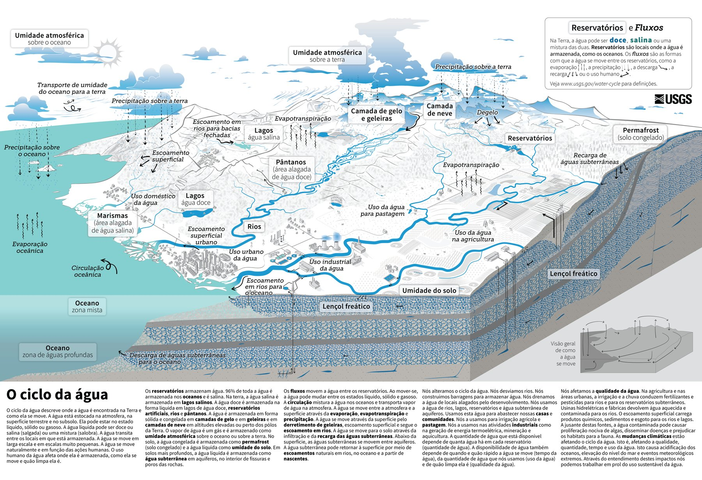

**Tradução em português** do post [First steps with SWAT+](/swat-plus-first-steps/) (versão original em inglês).
{: .notice--info}

Em outubro de 2026 ministrei o minicurso **"Introdução ao SWAT+ para iniciantes"** na Semana
Nacional de Ciência e Tecnologia (SNCT 2026) do IFBA, campus Vitória da Conquista: 8 horas, em
dois dias, para estudantes e profissionais que nunca tinham usado o SWAT. Este post reúne os
pontos que mais ajudaram os participantes. Não substitui a documentação, mas mostra o caminho
e os tropeços mais comuns.

<figure>
  
  <figcaption>Turma do minicurso MC07 na SNCT 2026 do IFBA, em Vitória da Conquista. Ministrei o curso a distância, da Áustria (na tela).</figcaption>
</figure>

## O que é o SWAT+

O **SWAT+** (*Soil and Water Assessment Tool Plus*) é um modelo de bacia hidrográfica
**contínuo no tempo** (passo diário), **semi-distribuído** e de **base física**: os parâmetros
vêm de solo, uso da terra e relevo, e têm significado físico. Ele estima vazão, balanço
hídrico, sedimentos, nutrientes e o efeito de cenários de manejo, uso do solo e clima.

<figure>
  
  <figcaption>O ciclo da água. Fonte: <a href="https://www.usgs.gov/special-topics/water-science-school/o-ciclo-da-agua-water-cycle-portuguese">USGS Water Science School</a>, tradução de Marcio Baldissera Cure (UFSC); domínio público.</figcaption>
</figure>

O SWAT+ é a reestruturação completa do SWAT 2012, desenvolvida pelo USDA-ARS e pela Texas A&M
University. As equações de processo são as mesmas; o que muda é a organização:

| Aspecto | SWAT 2012 | SWAT+ |
| --- | --- | --- |
| Interface GIS | ArcSWAT (ArcGIS, pago) ou QSWAT | QSWAT+ (QGIS, gratuito) |
| Banco de dados | Microsoft Access | SQLite |
| Conexões entre unidades | Arquivo `fig.fig`, rígido | Arquivos de conexão (`.con`), flexíveis |
| Hierarquia espacial | Bacia, sub-bacias, HRUs | Bacia, sub-bacias, unidades de paisagem (LSUs), HRUs e áreas de água |
| Manejo | Por data ou unidades de calor | Também por tabelas de decisão |
| Calibração | Altera os arquivos de entrada | `calibration.cal` sobrepõe valores sem alterar os originais |

A unidade de cálculo continua sendo a **HRU** (*hydrologic response unit*): a combinação única
de unidade de paisagem, uso do solo, solo e classe de declividade. A HRU não tem posição
geográfica contínua; é a soma de todas as células com a mesma combinação.

## Três programas, um modelo

O primeiro ponto de confusão é que o SWAT+ é, na prática, um conjunto de três programas:

| Componente | O que faz |
| --- | --- |
| **QSWAT+** (plugin do QGIS) | Prepara a parte espacial: delineia a bacia, cria LSUs e HRUs, visualiza resultados. **Não é o modelo.** |
| **SWAT+ Editor** | Importa o clima, define período, opções e saídas, escreve os arquivos-texto e roda o modelo |
| **SWAT+** (executável) | O modelo propriamente dito: lê os arquivos-texto em `TxtInOut` e escreve as saídas |

Tudo é instalado pelo [instalador oficial do SWAT+](https://swatplus.gitbook.io/docs/installation).
Use o **QGIS LTR de 64 bits**, que é a versão testada pelos desenvolvedores, e marque o download
do gerador climático global durante a instalação.

## Os dados: o que você precisa e onde encontrar no Brasil

Um modelo básico precisa de cinco conjuntos de dados, **todos na mesma projeção métrica**:

| Dado | Para que serve | Fontes para o Brasil |
| --- | --- | --- |
| Modelo digital de elevação | Drenagem, sub-bacias, declividade | SRTM 30 m, Copernicus GLO-30, ANADEM (ANA), TOPODATA (INPE) |
| Uso e cobertura da terra | Plantas, Curva Número e manejo de cada HRU | [MapBiomas](https://brasil.mapbiomas.org/) (coleções anuais, 30 m) |
| Solos | Camadas, textura, água disponível, condutividade | Mapas do IBGE e da Embrapa; SoilGrids para completar propriedades |
| Clima diário | Precipitação, temperatura, radiação, umidade, vento | INMET (BDMEP), ANA Hidroweb, grade BR-DWGD, CHIRPS, ERA5 |
| Vazão observada | Avaliar, calibrar e validar | ANA Hidroweb / SNIRH |

Na prática, o dado mais difícil é quase sempre a **tabela de propriedades dos solos**
(*usersoil*): profundidade, densidade, água disponível e condutividade de cada camada.

Duas regras evitam boa parte dos erros:

- O QSWAT+ assume que **todas as células têm a mesma área**. Um MDE em graus
  (latitude/longitude) precisa ser reprojetado antes; no Brasil, use SIRGAS 2000 / UTM do fuso da
  bacia ou uma projeção de área igual para bacias que cruzam fusos.
- Nomes de pastas e arquivos **sem espaços, acentos ou caracteres especiais**.

## Checklist antes de abrir o QSWAT+

Meia hora de checagem aqui economiza horas depois:

- [ ] MDE, uso e solo estão no mesmo sistema de coordenadas projetado
- [ ] Unidade vertical do MDE em metros
- [ ] Uso e solo cobrem toda a bacia, sem buracos de *NoData*
- [ ] Todo valor do raster de uso existe na tabela de correspondência de uso
- [ ] Todo valor do raster de solos existe na tabela de solos, e todo solo existe no *usersoil*
- [ ] O exutório está sobre (ou a menos de 300 m de) a drenagem gerada
- [ ] O período do clima cobre a simulação mais os anos de aquecimento
- [ ] Coordenadas das estações em graus decimais, com sinal negativo para Sul e Oeste

## O fluxo de trabalho em seis passos

1. **Criar o projeto** no QSWAT+ (botão SWAT+ no QGIS, *New Project*).
2. **Delinear a bacia:** carregar o MDE, definir os limiares de canal e de rio (limiares menores
   geram mais sub-bacias e um modelo mais lento), indicar o exutório.
3. **Criar as unidades de paisagem:** separar planície de inundação e encosta (método *DEM
   inversion* com os valores padrão é um bom começo).
4. **Gerar as HRUs:** mapas de uso e solo com suas tabelas, classes de declividade, e filtrar as
   combinações pequenas (por exemplo, 10% por uso, solo e declividade).
5. **Configurar no SWAT+ Editor:** importar gerador climático e clima observado, definir o
   período e os **anos de aquecimento** (*warm-up*, de 1 a 3 anos), escolher as saídas.
6. **Rodar e conferir:** uma rodada bem-sucedida termina com *Execution successfully completed*
   em `simulation.out`. Depois, use o **SWAT+ Check**, que aponta suspeitas (mas não diz que o
   modelo está errado).

Para aprender, comece com os dados de exemplo da bacia do Robit (Etiópia), que vêm com o
instalador: assim você separa os problemas do software dos problemas dos seus dados.

## Erros comuns e onde olhar

| Sintoma | Causa provável |
| --- | --- |
| O exutório não encaixa na drenagem (*0 snapped*) | Ponto longe da rede ou limiar de rio grande demais |
| Erro ao ler uso ou solo | Valor do raster ausente na tabela, ou projeções diferentes |
| Não chove em lugar nenhum | Coordenadas das estações fora da bacia (sinal da latitude/longitude) |
| Quase todo o fluxo é escoamento superficial | Curvas Número altas demais ou grupo hidrológico errado |
| As culturas não crescem | Manejo não atribuído ou plantio fora do período |
| O modelo para logo no início | Clima não cobre o período, ou arquivo referenciado ausente |

## Antes de calibrar: o balanço hídrico faz sentido?

Um modelo com hidrograma bonito e balanço hídrico absurdo está certo pelos motivos errados. Antes
de comparar com a vazão observada, abra `basin_wb_aa.txt` (média anual da bacia) e verifique:

- **Fechamento:** precipitação ≈ evapotranspiração + escoamento superficial + fluxo lateral +
  percolação + variação de armazenamento.
- **ET/P** compatível com o clima da região (ET maior que a precipitação é sinal de alerta).
- **Divisão do fluxo:** numa bacia perene com aquífero, quase tudo como escoamento superficial
  indica Curvas Número altas demais.
- **Vegetação:** em HRUs agrícolas, biomassa perto de zero indica problema de manejo.

Só depois vem a calibração: primeiro a **calibração suave** (ajustar as frações do balanço
hídrico a valores regionais), depois a **calibração rígida** com a vazão observada, e por fim a
**validação** num período independente. Como referência para vazão mensal,
[Moriasi et al. (2007)](https://doi.org/10.13031/2013.23153) consideram satisfatórios NSE > 0,50,
|PBIAS| < 25% e RSR ≤ 0,70.

## Para continuar aprendendo

- [Página oficial do SWAT+](https://swat.tamu.edu/software/plus/) e a
  [documentação](https://swatplus.gitbook.io/docs/installation), com a referência de cada arquivo
  de entrada e saída.
- O tutorial do QSWAT+ e o manual do SWAT+ Editor, instalados junto com o programa.
- O grupo de usuários do SWAT+ e as conferências SWAT anuais.
- Depois do primeiro modelo: tabelas de decisão para manejo, calibração automática e cenários de
  uso do solo e clima.

## Referências

- Arnold, J. G., Čerkasova, N., White, M., et al. *Soil and Water Assessment Tool Plus (SWAT+)*.
  Zenodo. [doi:10.5281/zenodo.14983533](https://doi.org/10.5281/zenodo.14983533)
- Moriasi, D. N., Arnold, J. G., Van Liew, M. W., Bingner, R. L., Harmel, R. D., & Veith, T. L.
  (2007). Model evaluation guidelines for systematic quantification of accuracy in watershed
  simulations. *Transactions of the ASABE, 50*(3), 885-900.
  [doi:10.13031/2013.23153](https://doi.org/10.13031/2013.23153)
- Neitsch, S. L., Arnold, J. G., Kiniry, J. R., & Williams, J. R. (2011). *Soil and Water
  Assessment Tool Theoretical Documentation, Version 2009*. Texas A&M University.
