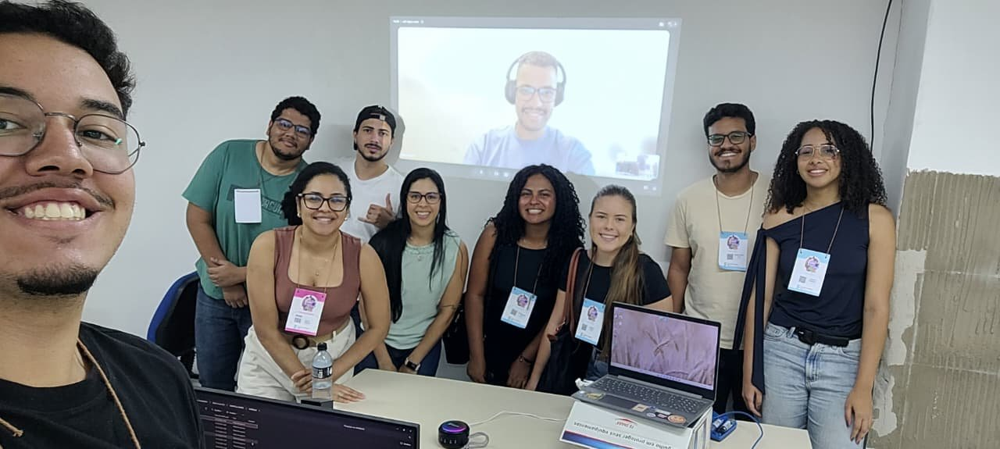

**Leia em português:** [Primeiros passos com o SWAT+](/primeiros-passos-swat-plus/)
{: .notice--info}

On 14 and 15 October 2026 (08:00-12:00 each day) I taught the short course **"Introduction to
SWAT+ for beginners"** at the National Science and Technology Week (SNCT 2026) of IFBA,
Vitória da Conquista campus, Brazil: 8 hours over two mornings, for students and professionals who had never used SWAT. This post
collects the points that helped participants most. It does not replace the documentation, but it
shows the path and the most common stumbling blocks.

<figure>
  
  <figcaption>Participants of the MC07 short course at SNCT 2026, IFBA Vitória da Conquista. I taught the course remotely from Austria (on screen).</figcaption>
</figure>

## What SWAT+ is

**SWAT+** (*Soil and Water Assessment Tool Plus*) is a watershed model that is **continuous in
time** (daily time step), **semi-distributed** and **physically based**: its parameters come from
soil, land use and topography, and have physical meaning. It estimates streamflow, the water
balance, sediments, nutrients and the effect of management, land-use and climate scenarios.

SWAT+ is a complete restructuring of SWAT 2012, developed by USDA-ARS and Texas A&M University.
The process equations are the same; the organisation is different:

| Aspect | SWAT 2012 | SWAT+ |
| --- | --- | --- |
| GIS interface | ArcSWAT (ArcGIS, commercial) or QSWAT | QSWAT+ (QGIS, free) |
| Database | Microsoft Access | SQLite |
| Connections between units | `fig.fig` file, rigid | Connect files (`.con`), flexible |
| Spatial hierarchy | Watershed, subbasins, HRUs | Watershed, subbasins, landscape units (LSUs), HRUs and water areas |
| Management | By date or heat units | Also by decision tables |
| Calibration | Edits the input files | `calibration.cal` overrides values without changing the originals |

The unit of calculation is still the **HRU** (*hydrologic response unit*): a unique combination
of landscape unit, land use, soil and slope class. An HRU has no continuous location; it is the
sum of all cells with the same combination.

## Three programs, one model

The first source of confusion is that SWAT+ is in practice a set of three programs:

| Component | What it does |
| --- | --- |
| **QSWAT+** (QGIS plugin) | Builds the spatial part: delineates the watershed, creates LSUs and HRUs, visualises results. **It is not the model.** |
| **SWAT+ Editor** | Imports climate data, sets the period, options and outputs, writes the text files and runs the model |
| **SWAT+** (executable) | The model itself: reads the text files in `TxtInOut` and writes the outputs |

Everything comes with the [official SWAT+ installer](https://swatplus.gitbook.io/docs/installation).
Use the **64-bit QGIS LTR**, the version tested by the developers, and tick the optional global
weather generator download during installation.

## The data you need

A basic model needs five datasets, **all in the same metric projection**:

| Data | Purpose | Example sources (Brazil) |
| --- | --- | --- |
| Digital elevation model | Drainage, subbasins, slope | [ANADEM](https://doi.org/10.3390/rs16132321), Copernicus GLO-30, SRTM 30 m, TOPODATA (INPE) |
| Land use and land cover | Plants, Curve Number and management for each HRU | [MapBiomas](https://brasil.mapbiomas.org/) (annual collections, 30 m) |
| Soils | Layers, texture, available water, conductivity | IBGE and Embrapa maps; SoilGrids to fill in properties |
| Daily climate | Precipitation, temperature, radiation, humidity, wind | INMET (BDMEP), ANA Hidroweb, BR-DWGD grid, CHIRPS, ERA5 |
| Observed streamflow | Evaluation, calibration and validation | ANA Hidroweb / SNIRH |

For delineation, prefer a **terrain model** such as ANADEM
([Laipelt et al., 2024](https://doi.org/10.3390/rs16132321)), which removes the vegetation bias of Copernicus GLO-30:
surface models such as SRTM and Copernicus include canopy height, which can shift the drainage
network in forested areas.

In practice, the hardest dataset is almost always the **soil property table** (*usersoil*):
depth, bulk density, available water and conductivity for every layer.

Two rules prevent most errors:

- QSWAT+ assumes **all cells have the same area**. A DEM in degrees (latitude/longitude) must be
  reprojected first, to the UTM zone of the watershed or to an equal-area projection for large
  basins.
- Folder and file names **without spaces, accents or special characters**.

**Lessons from a real project with Brazilian data:**

- **HIDROWEB streamflow:** use only the checked (*consistido*) series and read the status code of each day (1 real, 2 estimated, 3 doubtful, 4 dry gauge). Some years are entirely estimated; evaluate the model on real-status days. [CAMELS-BR](https://doi.org/10.5194/essd-12-2075-2020) is a useful cross-check.
- **Station metadata is not always right:** reported drainage areas can be wrong and old coordinates are rounded. Check the area against your delineation.
- **BR-DWGD gridded rainfall** ([Xavier et al., 2022](https://doi.org/10.1002/joc.7731)) matches gauges in totals and timing, but has too many light-rain days and too few heavy ones. With the Curve Number method that means less surface runoff, which calibration then hides. Compare wet-day and heavy-rain frequencies with ANA gauges before using it.
- **ZARC sowing windows** are insurance periods, not observed practice: use Conab crop progress for real sowing dates and IBGE PAM yields to check crop growth.

## Checklist before opening QSWAT+

Half an hour of checking here saves hours later:

- [ ] DEM, land use and soil maps share the same projected coordinate system
- [ ] The DEM's vertical unit is metres
- [ ] Land use and soil cover the whole watershed, with no *NoData* holes
- [ ] Every land-use raster value has a row in the land-use lookup table; an unknown class
      stops the work instead of defaulting to pasture
- [ ] Every soil raster value exists in the soil lookup table, and every soil exists in *usersoil*
- [ ] The outlet lies on (or within 300 m of) the generated drainage network
- [ ] The climate record covers the simulation period plus the warm-up years
- [ ] Station coordinates are in decimal degrees, negative for South and West
- [ ] A reused example project does not carry a leftover `calibration.cal`

## The workflow in six steps

1. **Create the project** in QSWAT+ (SWAT+ button in QGIS, *New Project*).
2. **Delineate the watershed:** load the DEM, set the channel and stream thresholds (smaller
   thresholds give more subbasins and a slower model), and add the outlet.
   Set the thresholds yourself (the defaults depend on the DEM size), then **check every outlet**: count how many snapped, and compare the delineated drainage area with the gauge's (a ratio outside 0.8-1.25 means the point is in the wrong place).
3. **Create landscape units:** separate floodplain and upslope areas (the *DEM inversion* method
   with default values is a good start).
4. **Generate HRUs:** land-use and soil maps with their lookup tables, slope classes, and a filter
   to drop small combinations (for example 10% for land use, soil and slope).
   Compare each land use's area **before and after** filtering: the filter can quietly absorb minority covers such as pasture or plantations. Protect them with *Exempt landuses*.
5. **Configure in the SWAT+ Editor:** import the weather generator and observed climate, set the
   period and the **warm-up years** (1 to 3), and choose the outputs.
6. **Run and check:** a successful run ends with *Execution successfully completed* in
   `simulation.out`. Then use **SWAT+ Check**, which flags suspicious values (but does not tell you
   the model is wrong).

To learn, start with the Robit example dataset (Ethiopia) that comes with the installer: it lets
you separate software problems from problems in your own data.

## Common errors and where to look

| Symptom | Likely cause |
| --- | --- |
| The outlet does not snap to the drainage (*0 snapped*) | Point too far from the network, or stream threshold too large |
| Error reading land use or soil | Raster value missing from the lookup table, or different projections |
| No rain anywhere | Station coordinates outside the watershed (sign of latitude/longitude) |
| Almost all flow is surface runoff | Curve Numbers too high, or wrong hydrologic soil group |
| Crops do not grow | No management assigned, or planting outside the period |
| The model stops right away | Climate does not cover the period, or a referenced file is missing |
| The run "succeeds" but results look odd | SWAT+ silently skips unknown names and missing weather files: search `diagnostics.out` for "not found" |
| Baseflow disappears in dry spells | Aquifer return-flow threshold (`flo_min`) too high |

## Before calibrating: does the water balance make sense?

A model with a beautiful hydrograph and an absurd water balance is right for the wrong reasons.
Before comparing with observed streamflow, open `basin_wb_aa.txt` (average annual watershed
balance) and check:

- **Closure:** precipitation ≈ evapotranspiration + surface runoff + lateral flow + percolation +
  change in storage.
- **ET/P** consistent with the regional climate (ET higher than precipitation is a red flag).
- **Flow partitioning:** in a perennial watershed with an aquifer, nearly all flow as surface
  runoff points to Curve Numbers that are too high.
- **Vegetation:** near-zero biomass in agricultural HRUs points to a management problem.
- **Plausibility:** forest ET should exceed cropland ET, and simulated yields should be near the municipal PAM yields.
- **Floodplain and upslope units:** with these landscape units, upslope runoff that runs on to the floodplain can be counted twice in `surq_gen` of `basin_wb`; close the balance with HRU, aquifer and channel outputs instead, and check this in your SWAT+ version.

Only then comes calibration: first **soft calibration** (matching the water-balance fractions to
regional values), then **hard calibration** against observed streamflow, and finally
**validation** on an independent period. As a reference for monthly streamflow,
[Moriasi et al. (2007)](https://doi.org/10.13031/2013.23153) consider NSE > 0.50, |PBIAS| < 25% and
RSR ≤ 0.70 satisfactory. Treat these thresholds as a convention for comparing runs, not as proof that a model is fit for purpose. NSE and [KGE (Gupta et al., 2009)](https://doi.org/10.1016/j.jhydrol.2009.08.003) are dominated by high flows, so calibrate crop growth and evapotranspiration before streamflow ([Piniewski et al., 2026](https://doi.org/10.1016/j.envsoft.2025.106794)), and also check hydrological signatures: the flow duration curve, Q95, the baseflow index and the monthly regime.

## Keep learning

- The [official SWAT+ page](https://swat.tamu.edu/software/plus/) and the
  [documentation](https://swatplus.gitbook.io/docs/installation), with a reference for every
  input and output file.
- The QSWAT+ tutorial and the SWAT+ Editor manual, installed with the software.
- The SWAT+ user group and the annual SWAT conferences.
- After your first model: decision tables for management, automatic calibration, and land-use
  and climate scenarios.
- **A complete SWAT+ workflow, step by step:** the [OPTAIN CS10 documentation](https://moritzshore.github.io/optain-cs10/) by
  Moritz Shore and colleagues documents a reproducible SWAT+ setup for the Kråkstad catchment
  (Norway), from input data and model setup to management, model verification, soft and hard
  calibration, and land-use, climate and measure scenarios. It is a work in progress, but an
  excellent guide to the steps that come after your first model.
- **The OPTAIN project:** [project website](https://www.optain.eu/) and
  [Zenodo community](https://zenodo.org/communities/optain-h2020-project/), with protocols,
  reports and data. Highlights: the
  [SWAT+ modelling protocol](https://doi.org/10.5281/zenodo.7463395) applied in 14 European
  agricultural catchments (Schürz et al., 2022), the
  [common optimisation protocol](https://doi.org/10.5281/zenodo.11473793) for water and nutrient
  retention measures (Strauch & Schürz, 2024) and the field-scale SWAP modelling protocol
  (Farkas et al., 2023): good examples of how to document a modelling study.
- **R packages from the OPTAIN workflow:** [SWATprepR](https://biopsichas.github.io/SWATprepR/)
  (input data preparation), [SWATfarmR](https://chrisschuerz.github.io/SWATfarmR/) (management
  schedules) and [SWATrunR](https://chrisschuerz.github.io/SWATrunR/) (running and calibrating
  SWAT+ from R; formerly SWATplusR). There is also an
  [R workflow to generate SWATfarmR input](https://doi.org/10.5281/zenodo.17531016) from
  field-scale crop rotations (Strauch, 2025). SWATbuildR and SWATdoctR are part of the workflow
  too, with restricted access.
- **Calibrating crops, not just streamflow:** [Piniewski et al. (2026)](https://doi.org/10.1016/j.envsoft.2025.106794) show a crop growth and yield calibration workflow for SWAT+ and its effect on water, sediment and nutrient results in ten catchments.

## References

- Arnold, J. G., Čerkasova, N., White, M., et al. *Soil and Water Assessment Tool Plus (SWAT+)*.
  Zenodo. [doi:10.5281/zenodo.14983533](https://doi.org/10.5281/zenodo.14983533)
- Chagas, V. B. M., et al. (2020). CAMELS-BR: hydrometeorological time series and landscape
  attributes for 897 catchments in Brazil. *Earth System Science Data, 12*(3), 2075-2096.
  [doi:10.5194/essd-12-2075-2020](https://doi.org/10.5194/essd-12-2075-2020)
- Farkas, C., Shore, M., Cüceloglu, G., Czelnai, L., Nemes, A., Szabó, B., Čerkasova, N.,
  Idzelyté, R., & Weiland, S. (2023). *SWAP field-scale modelling protocol*. OPTAIN project
  deliverable. Zenodo. [doi:10.5281/zenodo.7907114](https://doi.org/10.5281/zenodo.7907114)
- Gupta, H. V., Kling, H., Yilmaz, K. K., & Martinez, G. F. (2009). Decomposition of the mean
  squared error and NSE performance criteria: implications for improving hydrological modelling.
  *Journal of Hydrology, 377*(1-2), 80-91.
  [doi:10.1016/j.jhydrol.2009.08.003](https://doi.org/10.1016/j.jhydrol.2009.08.003)
- Laipelt, L., Comini de Andrade, B., Collischonn, W., de Amorim Teixeira, A., Paiva, R. C. D.,
  & Ruhoff, A. (2024). ANADEM: A digital terrain model for South America. *Remote Sensing,
  16*(13), 2321. [doi:10.3390/rs16132321](https://doi.org/10.3390/rs16132321)
- Moriasi, D. N., Arnold, J. G., Van Liew, M. W., Bingner, R. L., Harmel, R. D., & Veith, T. L.
  (2007). Model evaluation guidelines for systematic quantification of accuracy in watershed
  simulations. *Transactions of the ASABE, 50*(3), 885-900.
  [doi:10.13031/2013.23153](https://doi.org/10.13031/2013.23153)
- Neitsch, S. L., Arnold, J. G., Kiniry, J. R., & Williams, J. R. (2011). *Soil and Water
  Assessment Tool Theoretical Documentation, Version 2009*. Texas A&M University.
- Piniewski, M., Čerkasova, N., Plunge, S., Strauch, M., Schürz, C., et al. (2026). Enhanced crop
  calibration for SWAT+: evaluating water, sediment and nutrient impacts across ten European
  catchments. *Environmental Modelling & Software, 196*, 106794.
  [doi:10.1016/j.envsoft.2025.106794](https://doi.org/10.1016/j.envsoft.2025.106794)
- Schürz, C., Čerkasova, N., Farkas, C., Nemes, A., Plunge, S., Strauch, M., Szabó, B., &
  Piniewski, M. (2022). *SWAT+ modeling protocol for the assessment of water and nutrient
  retention measures in small agricultural catchments*. OPTAIN project deliverable. Zenodo.
  [doi:10.5281/zenodo.7463395](https://doi.org/10.5281/zenodo.7463395)
- Strauch, M. (2025). *R workflow to generate SWATfarmR input* (v1.0) [Software]. Zenodo.
  [doi:10.5281/zenodo.17531016](https://doi.org/10.5281/zenodo.17531016)
- Strauch, M., & Schürz, C. (2024). *Common optimisation protocol*. Deliverable D5.1 of the EU
  Horizon 2020 project OPTAIN. Zenodo.
  [doi:10.5281/zenodo.11473793](https://doi.org/10.5281/zenodo.11473793)
- Xavier, A. C., Scanlon, B. R., King, C. W., & Alves, A. I. (2022). New improved Brazilian daily
  weather gridded data (1961-2020). *International Journal of Climatology, 42*(16), 8390-8404.
  [doi:10.1002/joc.7731](https://doi.org/10.1002/joc.7731)
